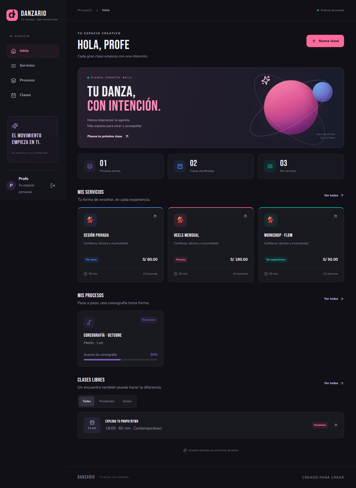
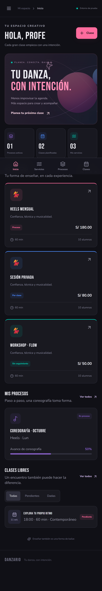

# Verification record

Verified locally on October 11, 2026, using Node 24, Java 21, and Firebase Auth/Firestore emulators for `demo-danzario`.

| Check                                           | Result                                |
| ----------------------------------------------- | ------------------------------------- |
| TypeScript type check                           | Passed                                |
| ESLint                                          | Passed                                |
| Production build                                | Passed                                |
| Planning/domain tests                           | 8 passed                              |
| Firestore ownership/schema tests                | 10 passed                             |
| Desktop Chromium teacher workflows              | 6 passed                              |
| iPhone-sized Chromium teacher workflows         | 6 passed                              |
| 375px and 390px overflow/navigation checks      | Passed, included in browser workflows |
| Production dependencies, `npm audit --omit=dev` | 0 vulnerabilities                     |

The complete teacher workflow creates a process service, monthly cycle with student goals/criteria, and a class with inherited itinerary and roster. It records attendance and emotional check-ins, refreshes, verifies attendance percentages, tracks choreography sections, reverses class completion, and verifies dependency-blocked deletion. Separate tests cover editing/deleting every record type, failed-save recovery, dirty-form warnings, free-class filters, clearing records across sign-out/account changes, and live subscriptions during ordinary in-app navigation.

The WebKit test records the documented [document-replacement XHR diagnostic bug](https://github.com/microsoft/playwright/issues/43120). Its exception applies only to emulator Firestore Listen/Write channel access-control messages emitted while an explicitly tracked hard navigation is pending. All other page errors fail the test. A separate in-app navigation control has no diagnostic exceptions and requires zero page errors.

All tests use local emulator data. The isolated test teachers and screenshot examples are not seeded into production.

## Screenshots

## Remaining external checks

- **Safari/WebKit:** the downloaded Windows WebKit browser cannot launch on this host. Desktop and iPhone-sized Chromium pass; the WebKit project remains in the Linux CI suite but has not been verified locally. Actual iPhone safe-area and Google popup behavior require device verification.
- **Cloud Firebase:** a new real project, Google provider, rules deployment, and authorized domains are not yet configured. Google cloud sign-in and cloud Firestore writes are therefore not claimed as verified.
- **Vercel preview:** no Danzario project was found in the connected Vercel account. Configuration and setup instructions are included; no hosted preview or production release is claimed.
- **Development tooling audit:** 11 advisories remain in Firebase CLI transitive development dependencies, including an upstream `braces` advisory with no newer published version at verification time. These are not included in the shipped browser dependency tree. No broad forced downgrade or untested transitive major override was applied.
- **Build size:** Vite reports a Firebase vendor chunk above its 500 kB warning threshold (approximately 164 kB compressed). The production build succeeds; this is a performance warning, not a build failure.

The app blocks linked deletion through a fresh client-side dependency query. Cross-device concurrent writes and direct external database edits are not transactionally protected against orphaned references; ownership and parent-access rules remain enforced.
